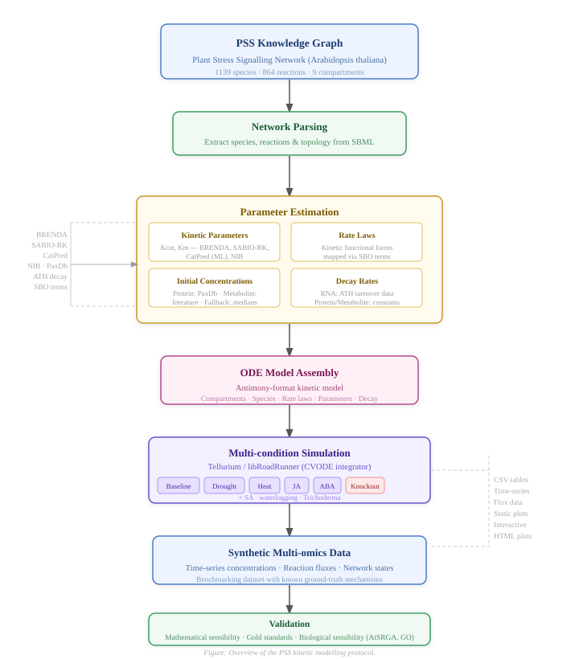

# PSS Kinetic Modelling Pipeline

**Master's Thesis — Radoslav Atanasoski**  
*Generating dynamic large-scale systems-biology data from a knowledge graph*  
University of Ljubljana, Faculty of Computer and Information Science, 2026  
Supervisor: Assoc. Prof. Tomaž Curk · Co-supervisor: Asst. Prof. Anže Županič

This repository builds and simulates an ODE kinetic model of the *Arabidopsis thaliana* Plant Stress Signalling (PSS) network. Starting from a PSS SBML network file, the pipeline constructs an Antimony-format ODE model and simulates it under multiple stress conditions (drought, heat, JA, ABA, waterlogging, …).

---

## Requirements

| Tool | Version | Install |
|---|---|---|
| [Nextflow](https://www.nextflow.io/docs/latest/install.html) | >= 23.04 | `curl -s https://get.nextflow.io \| bash` |
| [Conda](https://docs.conda.io/en/latest/miniconda.html) | any | [Miniconda installer](https://docs.conda.io/en/latest/miniconda.html) |

Conda is used by Nextflow to manage the Python environment automatically on first run.

---

## Quick Start — Run the Pipeline

```bash
git clone https://github.com/R4d0slav/ThesisRepository.git
cd ThesisRepository

nextflow run main.nf
```

Nextflow creates the Conda environment from `thesis_env.yml` on the first run (takes a few minutes). Subsequent runs reuse the cached environment.

**Resume a previous run** (skips already-completed steps):
```bash
nextflow run main.nf -resume
```

**Select a profile:**
```bash
nextflow run main.nf -profile local    # laptop / workstation (default)
nextflow run main.nf -profile slurm   # HPC cluster via SLURM
nextflow run main.nf -profile debug   # extra Nextflow verbosity
```

Results are written to `results/` (see [Output Structure](#output-structure) below).

---

## Running via the Web UI

The web UI lets you configure and launch the pipeline with a point-and-click interface, monitor live logs, browse results, compare simulations, run parameter scans, and visualise the network.

**1. Install UI dependencies** (into your active environment or thesis_env):
```bash
conda activate thesis_env   # or: pip install into any Python 3 env
pip install flask flask-cors pandas openpyxl scikit-learn numpy
```

Nextflow must also be on `PATH` for the pipeline to launch from the UI.

**2. Start the server:**
```bash
cd ui
python3 app.py
```

**3. Open** `http://localhost:5001` in a browser.

> For detailed UI documentation — panels, API reference, data formats, and key concepts — see [`ui/README.md`](ui/README.md).

---

## Running Notebooks

Jupyter notebooks under `notebooks/` mirror every pipeline step and are useful for exploration, debugging, and visualisation.

```bash
conda env create -f thesis_env.yml   # first time only
conda activate thesis_env
export PYTHONPATH=$(pwd):$PYTHONPATH
jupyter lab
```

Each notebook imports shared constants and paths from `scripts/utils.py` via `from scripts.utils import ...`.

| Notebook | Stage |
|---|---|
| `0_Comparing_Kinetics.ipynb` | Exploratory kinetics comparison |
| `1_processPSS.ipynb` | PSS network parsing |
| `2_decayRates.ipynb` | Decay rate mapper |
| `3_concentrations.ipynb` | Initial concentration mapper |
| `4_rateLaws.ipynb` | Rate law mapper |
| `5_kineticParameters.ipynb` | Kinetic parameter mapper |
| `6_antimony.ipynb` | Antimony model builder |
| `7_simulation.ipynb` | Simulation and visualisation |

---

## Pipeline Overview



The pipeline is defined in `main.nf` and split into modules under `modules/`. Each module calls a corresponding Python script in `scripts/modeling/`.

```
Stage 1 — Parse PSS Network
  processPSS.nf  →  process_pss.py
    Reads the SBML file → species.json, reactions.json

Stage 2 — Build Parameter Mappers  [all four run in parallel]
  decayRates.nf          →  decay_rates.py       →  decay_rate_mapper.pkl
  initialConcentrations.nf → concentrations.py   →  concentration_mapper.pkl
  rateLaws.nf            →  rate_laws.py         →  rate_law_mapper.pkl
  kineticParameters.nf   →  kinetic_parameters.py → kinetic_parameter_mapper.pkl

Stage 3 — Assemble Antimony Model
  buildAntimony.nf  →  build_antimony.py
    Merges network topology + all four mappers → Antimony.txt

Stage 4 — Run Simulations  [each condition runs in parallel]
  simulatePSS.nf  →  simulate.py
    Loads Antimony.txt into Tellurium/RoadRunner → CSVs, plots, HTML
```

### Simulation Conditions

Each simulation condition is one stress scenario. Conditions are defined either:
- **In the UI** (recommended): via the Simulation Conditions table, written to `tmp/sim_<id>.json` at launch time.
- **In `main.nf` directly**: edit the `channel.from([...])` fallback list.

Each condition specifies:
```nextflow
[start: 0, end: 1_000, points: 1_000, suffix: 'drought',
 events: file("data/events/intervention/drought.json")]
```

Available event files:

| File | Description |
|---|---|
| `data/events/intervention/drought.json` | Drought stress |
| `data/events/intervention/heat.json` | Heat stress |
| `data/events/intervention/ja.json` | Jasmonic acid treatment |
| `data/events/intervention/aba.json` | Abscisic acid treatment |
| `data/events/intervention/sa.json` | Salicylic acid treatment |
| `data/events/intervention/waterlogging.json` | Waterlogging |
| `data/events/intervention/trichousbacteria.json` | Trichoderma / beneficial bacteria |
| `data/events/knockout/coi1.json` | COI1 knockout |
| `data/events/knockout/cbl2.json` | CBL2 knockout (calcium sensor) |

---

## Output Structure

All outputs land in `results/` after a successful run:

```
results/
├── processPSS/
│   ├── species.json          1139 species — id, name, type, compartment
│   └── reactions.json        864 reactions — reactants, products, modifiers
├── decayRates/
│   └── decay_rate_mapper.pkl
├── initialConcentrations/
│   └── concentration_mapper.pkl
├── rateLaws/
│   └── rate_law_mapper.pkl
├── kineticParameters/
│   └── kinetic_parameter_mapper.pkl
├── buildAntimony/
│   └── Antimony.txt          Complete ODE model in Antimony syntax
└── simulatePSS/
    ├── tables/               simulation_<suffix>.csv — time-series per condition
    ├── images/               simulation_<suffix>.jpg — static plots
    └── interactive/          simulation_<suffix>.html — interactive Plotly plots
```

`results/`, `work/`, `tmp/`, and `logs/` are gitignored — they are generated locally and not committed.

---

## Data Files

All input files live in `data/`:

| File | Description |
|---|---|
| `output-laws-RISC_ignored_10112025.sbml` | PSS network — 1139 species, 864 reactions |
| `ath_decay_rates.tsv` | *A. thaliana* RNA/protein decay rates |
| `Initial_Concentrations.csv` | Protein and metabolite concentrations (PaxDb + literature) |
| `reactions_by_combination.xlsx` | Rate law functional forms per reaction class |
| `Reactions_kinetics.xlsx` | Gathered kinetic parameters (BRENDA, SABIO-RK, CatPred) |
| `reactions-2025.02.04.xlsx` | NIB annotated parameters (Km, Kcat with units) |

---

## Repository Structure

```
ThesisRepository/
├── main.nf                   Nextflow workflow
├── nextflow.config           Profiles and parameter defaults
├── thesis_env.yml            Conda environment
├── reset.sh                  Wipe runtime outputs (results/, work/, tmp/)
├── modules/                  Nextflow modules (one per stage)
├── scripts/
│   ├── utils.py              Shared paths/constants for notebooks
│   ├── pss_adapter_cli.py    Upstream PSS/Neo4j → SBML export tool
│   └── modeling/             Pipeline Python scripts
├── data/                     All input data and event files
├── notebooks/                Jupyter notebooks (one per pipeline stage)
├── ui/                       Web UI (Flask + Vanilla JS)
│   └── README.md             Full UI reference
├── documentation/            Thesis planning documents
├── LICENSE                   GNU GPL v3
└── README.md                 This file
```

---

## Resetting the Workspace

To delete all generated outputs and start fresh:
```bash
bash reset.sh
```

Or from within the UI, use the **Clean** button in the Pipeline panel.

---

## License

This project is licensed under the GNU General Public License v3.0 or later. See [`LICENSE`](LICENSE) for the full text.
